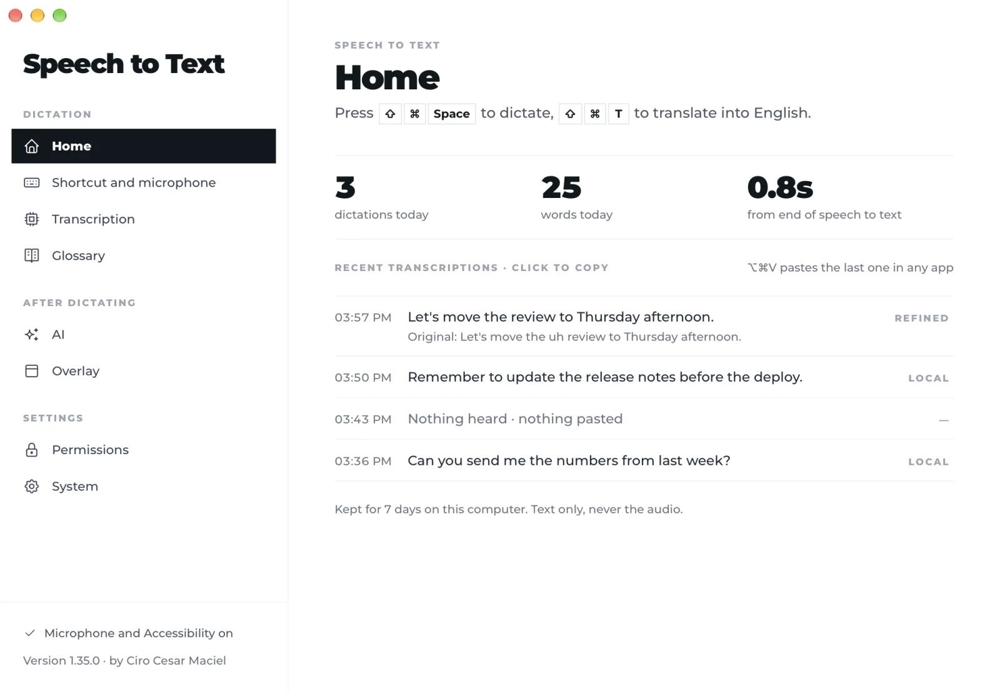

# Speech to Text by Ciro Cesar Maciel

**Dictation for the Mac: press a key, speak, and the text is typed where your cursor is.**

One of [six free, open-source Mac apps](#more-from-ciro-cesar-maciel) by [Ciro Cesar Maciel](https://ciromaciel.click/?ref=oss-speech-to-text).

Transcription runs on your Mac with [whisper.cpp](https://github.com/ggml-org/whisper.cpp). Your voice is never uploaded: the audio becomes text on your machine and is thrown away. No account, no minute quota, no telemetry. A menu bar app built with Tauri and Rust.

[Português](README.pt-BR.md)



## Install

```bash
curl -fsSL https://blob.ciromaciel.click/tools/speech-to-text/install.sh | bash
```

The script downloads the latest `.dmg`, copies Speech to Text to `/Applications` and opens it.

Prefer the disk image? [Download Speech-to-Text-macos.dmg](https://blob.ciromaciel.click/tools/speech-to-text/latest/Speech-to-Text-macos.dmg). Open it and drag Speech to Text to Applications. It is signed with Developer ID and notarized by Apple, so macOS opens it with no warning.

On first start, macOS asks for two permissions: **Microphone** (to hear you) and **Accessibility** (to paste the text where your cursor is). Installed copies keep themselves up to date.

## How it works

1. Put the cursor where the text should go, in any app.
2. Press **Cmd + Shift + Space** and speak. A small indicator shows it is listening.
3. Press again (or, in hold mode, let go). The text is pasted at the cursor, punctuated and capitalized.

| Shortcut | What it does |
| --- | --- |
| Cmd + Shift + Space | Dictate. Toggle by default; hold-to-talk with double tap for hands-free is one setting away |
| Cmd + Shift + T | Dictate and paste the text translated into the language you picked (optional, see below) |
| Cmd + Option + V | Paste the last transcription again |
| Esc | Cancel while recording; nothing is pasted |

Every shortcut can be changed in the settings window, opened from the menu bar icon.

## What it does

| Feature | Detail |
| --- | --- |
| Local transcription | whisper.cpp with Metal, kept loaded in memory so the first word does not wait for a cold start |
| Models | tiny, base, small, medium and large-v3-turbo; the app downloads the one you choose from Hugging Face |
| Languages | Portuguese, English, Spanish, French, German, Italian, or automatic detection |
| Interface | English and Brazilian Portuguese, following the Mac's language |
| Voice detection | Silero VAD trims silence before Whisper sees the audio |
| Glossary | Names, brands and acronyms written the way you registered them |
| Refine and translate | Optional. Cleans up hesitations or translates the dictation through [OpenRouter](https://openrouter.ai), with your own key and the model you pick |
| History | What you dictated, text only, kept on your Mac for 7 or 30 days, or only in memory |
| Clipboard | Used for under half a second to paste, then restored to what it held before |

## Privacy

What leaves your Mac, and only then:

- **Downloading a model**, from Hugging Face, when you choose one.
- **Checking for updates**, from `blob.ciromaciel.click`, a minute after start and every 6 hours.
- **Refine and translate**, only if you turn them on: the transcribed text (never the audio) goes to OpenRouter with your key.

Nothing else. The interface font is bundled with the app, there is no analytics and no account.

## Build it yourself

You need the Xcode Command Line Tools, [Rust](https://rustup.rs), [Bun](https://bun.sh) and CMake (`brew install cmake`).

```bash
git clone https://github.com/ciro-maciel/speech-to-text.git
cd speech-to-text
bun install
bash scripts/whisper.sh      # builds whisper.cpp from source and fetches the voice detector
bun run dev                  # or: bun run build → src-tauri/target/release/bundle
```

`scripts/whisper.sh` builds `whisper-cli` and `whisper-server` from a pinned whisper.cpp tag and places them where Tauri expects its sidecars. The speech models are not in the repository: the app downloads them on demand into `~/Library/Application Support/speech-to-text/models`.

A local build is signed ad hoc, so macOS asks for Microphone and Accessibility again after each rebuild. The official build is signed with Developer ID (`scripts/release/build-mac.sh`).

For development, an `.env` file at the repository root can set `OPENROUTER_API_KEY` and `OPENROUTER_MODEL`, the defaults of the Refine and Translate settings.

Check a build end to end on your Mac (the app runs with a throwaway home folder and never touches your settings):

```bash
scripts/smoke-test.sh "src-tauri/target/release/bundle/macos/Speech to Text.app/Contents/MacOS/speech-to-text" \
    src-tauri/target/release/bundle/macos/"Speech to Text.app"/Contents/MacOS \
    path/to/ggml-tiny.bin path/to/jfk.wav
```

## Limits

- Published for macOS 11 or newer on Apple Silicon only. The code is Tauri and also builds for Windows and Linux, but those builds are not published or maintained right now.
- Pasting needs Accessibility permission; without it, the text stays on the clipboard.

## Contributing

Issues and pull requests are welcome. See [CONTRIBUTING.md](CONTRIBUTING.md).

## License

[MIT](LICENSE). whisper.cpp, the Silero voice detector, Montserrat and the icons keep their own licenses: see [NOTICE](NOTICE).

---

## More from Ciro Cesar Maciel

I build software on my own, with a team of AI agents, and open what I can. Six native Mac apps, all free, MIT, signed and notarized by Apple, in English and Brazilian Portuguese: [Cleaner](https://github.com/ciro-maciel/cleaner), the Mac cleaner that shows you everything before it deletes anything · [Screenshots](https://github.com/ciro-maciel/screenshots), capture, annotate and record the screen, with nothing leaving your Mac · [Speech to Text](https://github.com/ciro-maciel/speech-to-text), dictation by shortcut, with Whisper running on your Mac (this one) · [Assistant](https://github.com/ciro-maciel/voice-assistant), Claude Code by voice · [Windows](https://github.com/ciro-maciel/windows), snap windows into place with a shortcut or by dragging them to the edge · [Text to Speech](https://github.com/ciro-maciel/text-to-speech), select text in any app and hear it read aloud.

Beyond the apps: [free tools for the browser](https://ciromaciel.click/tools?ref=oss-speech-to-text), [books](https://ciromaciel.click/books?ref=oss-speech-to-text), and [Infrastructure](https://myinfrastructure.click/?ref=oss-speech-to-text), the infrastructure AI agents already know how to run.

**Follow along.** [Follow @ciro-maciel](https://github.com/ciro-maciel) for the next open-source apps, click **Watch → Custom → Releases** above for every new version, and see how it is all made on [YouTube](https://www.youtube.com/@ciro-maciel) and at [ciromaciel.click](https://ciromaciel.click/?ref=oss-speech-to-text).
