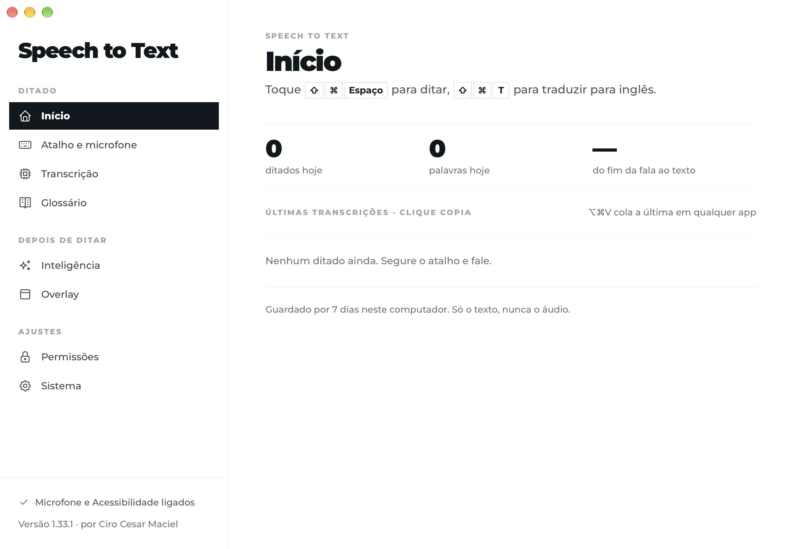

# Speech to Text by Ciro Cesar Maciel

**Ditado para Mac: aperte uma tecla, fale, e o texto aparece onde está o cursor.**

Um dos [seis apps de Mac grátis e de código aberto](#mais-de-ciro-cesar-maciel) de [Ciro Cesar Maciel](https://ciromaciel.click/?ref=oss-speech-to-text).

**[Veja o vídeo de 1 minuto](https://youtu.be/FjEQF7LmHqg)** (em inglês)

[](https://www.opensourcealternatives.to) [](https://alternativeto.net/software/speech-to-text-by-ciro-cesar-maciel/about/?utm_source=badge&utm_medium=referral)

A transcrição roda no seu Mac, com o Parakeet da NVIDIA no Neural Engine, pelo [FluidAudio](https://github.com/FluidInference/FluidAudio). Sua voz nunca é enviada: o áudio vira texto na sua máquina e é descartado. Sem conta, sem cota de minutos, sem telemetria. Um app nativo de barra de menus, em Swift: 22 MB em disco e cerca de 60 MB de memória com o modelo carregado.

[English](README.md)



## Instalar

```bash
curl -fsSL https://blob.ciromaciel.click/tools/speech-to-text/install.sh | bash
```

O script baixa o `.dmg` mais recente, copia o Speech to Text para `/Applications` e abre.

Com o [Homebrew](https://github.com/ciro-maciel/homebrew-tap): `brew install --cask ciro-maciel/tap/ciro-speech-to-text`.

Prefere a imagem de disco? [Baixe o Speech-to-Text-macos.dmg](https://blob.ciromaciel.click/tools/speech-to-text/latest/Speech-to-Text-macos.dmg). Abra e arraste o Speech to Text para Aplicativos. Ele é assinado com Developer ID e notarizado pela Apple, então o macOS abre sem aviso.

Na primeira vez, o macOS pede duas permissões: **Microfone** (para ouvir você) e **Acessibilidade** (para colar o texto onde está o cursor), e o app abre em Transcrição para baixar o modelo de fala (643 MB, uma vez só).

## Como funciona

1. Deixe o cursor onde o texto deve entrar, em qualquer app.
2. Aperte **Cmd + Shift + Espaço** e fale. Um indicador discreto mostra que está ouvindo.
3. Aperte de novo (ou, no modo segurar, solte). O texto é colado no cursor, com pontuação e maiúsculas.

| Atalho | O que faz |
| --- | --- |
| Cmd + Shift + Espaço | Ditar. Liga e desliga por padrão; segurar para falar, com toque duplo para mãos livres, está a um ajuste |
| Cmd + Shift + T | Ditar e colar o texto já traduzido para o idioma escolhido (opcional, veja abaixo) |
| Cmd + Option + V | Colar de novo a última transcrição |
| Esc | Cancelar durante a gravação; nada é colado |

Todos os atalhos podem ser trocados na janela de ajustes, aberta pelo ícone na barra de menus.

## O que ele faz

| Recurso | Detalhe |
| --- | --- |
| Transcrição local | O Parakeet da NVIDIA no Neural Engine, dentro do próprio app. Em português do Brasil ele errou menos que o Whisper large-v3-turbo (3,6% contra 3,7% em frases curtas, 3,5% contra 21,6% em ditados de dois minutos, em que o whisper.cpp pulava frases inteiras), com cerca de 80 MB em vez de 2 GB. Dois minutos de fala viram texto em cerca de meio segundo |
| Idiomas | Os 25 idiomas europeus que o Parakeet conhece, português e inglês entre eles |
| Interface | Inglês e português do Brasil, seguindo o idioma do Mac |
| Silêncio | O Parakeet devolve nada para silêncio e ruído de ambiente, então um toque sem fala não cola nada |
| Microfone | Abre no atalho e um sinal avisa quando falar; fica fechado entre ditados, então a bolinha laranja apaga. Opcionalmente fica pronto, sem espera e guardando os últimos 300 ms |
| Glossário | Nomes, marcas e siglas que o refinamento escreve do jeito que você cadastrou |
| Refinar e traduzir | Opcional. Tira hesitações ou traduz o ditado pelo [OpenRouter](https://openrouter.ai), com a sua chave e o modelo que você escolher |
| Histórico | O que você ditou, só texto, guardado no seu Mac por 7 ou 30 dias, ou só na memória |
| Área de transferência | Usada por menos de meio segundo para colar, e depois volta ao que tinha antes |

## Privacidade

O que sai do seu Mac, e só nesses casos:

- **Baixar o modelo**, do Hugging Face, uma vez.
- **Refinar e traduzir**, só se você ligar: o texto transcrito (nunca o áudio) vai para o OpenRouter com a sua chave.

Mais nada. A fonte da interface vem dentro do app, e não há analytics nem conta. A chave do OpenRouter fica no Keychain do macOS.

## Compilar você mesmo

Você precisa de macOS 14 ou mais novo em Apple Silicon e das Xcode Command Line Tools (Swift 5.10 ou mais novo).

```bash
git clone https://github.com/ciro-maciel/speech-to-text.git
cd speech-to-text
scripts/build.sh             # → dist/Speech to Text.app
```

O build é um pacote Swift (o FluidAudio é a única dependência) que o `scripts/build.sh` embrulha no app. O modelo de fala não fica no repositório: o app baixa sob demanda para `~/Library/Application Support/speech-to-text/models/parakeet-ultra`.

Sem um certificado Developer ID, o build é assinado ad hoc, então o macOS pede Microfone e Acessibilidade de novo a cada build. O `scripts/dist.sh` sobe a versão, compila, empacota o `.dmg`, manda a Apple notarizar (perfil `notary` do Keychain) e instala.

## Limites

- macOS 14 ou mais novo, em Apple Silicon.
- Colar precisa da permissão de Acessibilidade; sem ela, o texto fica na área de transferência.
- Ainda sem atualização automática: instale a versão nova do mesmo jeito que a primeira.

## Contribuir

Issues e pull requests são bem-vindos. Veja o [CONTRIBUTING.md](CONTRIBUTING.md).

## Licença

[MIT](LICENSE). O FluidAudio, o modelo Parakeet, a Montserrat e os ícones mantêm as próprias licenças: veja o [NOTICE](NOTICE).

---

## Mais de Ciro Cesar Maciel

Eu construo software sozinho, com uma equipe de agentes de IA, e abro o que dá para abrir. Seis apps nativos para Mac, todos grátis, MIT, assinados e notarizados pela Apple, em inglês e português do Brasil: [Cleaner](https://github.com/ciro-maciel/cleaner), o limpador de Mac que mostra tudo antes de apagar qualquer coisa · [Screenshots](https://github.com/ciro-maciel/screenshots), captura, anotação e gravação de tela, sem nada sair do Mac · [Speech to Text](https://github.com/ciro-maciel/speech-to-text), ditado por atalho, com o Parakeet rodando no Mac (este) · [Assistant](https://github.com/ciro-maciel/voice-assistant), o Claude Code por voz · [Windows](https://github.com/ciro-maciel/windows), janelas no lugar com um atalho ou levando até a borda · [Text to Speech](https://github.com/ciro-maciel/text-to-speech), selecione um texto em qualquer app e ouça.

Além dos apps: [ferramentas grátis no navegador](https://ciromaciel.click/tools?ref=oss-speech-to-text), [livros](https://ciromaciel.click/books?ref=oss-speech-to-text) e o [Infrastructure](https://myinfrastructure.click/?ref=oss-speech-to-text), a infraestrutura que os agentes já sabem operar.

**Toda semana, por e-mail:** as [Cartas do Ciro](https://ciromaciel.click/?ref=oss-speech-to-text), o que estou construindo e aprendendo.

**Acompanhe.** [Siga @ciro-maciel](https://github.com/ciro-maciel) para os próximos apps abertos, clique em **Watch → Custom → Releases** aqui em cima para saber de cada versão nova, e veja como tudo é feito no [YouTube](https://www.youtube.com/@ciro-maciel).
